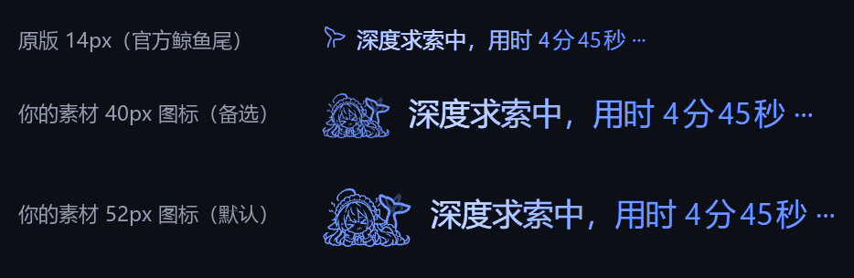

# DSH 深度思考表情包

把对话末尾「深度求索中，用时 …」前面的小鲸鱼尾巴，换成会动的 Q 版表情动画：
每次思考随机抽一张，抽中的那张循环播放。

官方图标是 `@deepseek-ai/dsh-client-ui-chat` 里一只 28×28 的 APNG 鲸鱼尾，作为 **CSS mask**
绘制在 14×14 的图标位里，颜色取 `currentColor`。本插件沿用同一机制：把五张 GIF 逐帧抠图、
转成循环 WebP，每次思考随机抽一张作为 mask；颜色取自当前主题的「深度求索」文字色
（`--dsw-alias-label-deep-diving`），所以换肤和明暗主题都不用改图。

## 效果



浅色主题（图标和文字都取自当前主题的「深度求索」颜色，换肤自动跟随）：


- 藏掉官方鲸鱼（`_runningWhaleAnimated` + `_runningWhaleStill`），在图标盒上画自己的 glyph；
- **每次思考随机抽一张动画**：运行状态行每次重新出现时，从五张里抽一张，抽中的那张会
  **循环播放它自己的 GIF 动画**（约 24fps，各 5 秒），不会连着两次同一张；
- 52px 图标 + 16.8px 文字（官方是 14px 图标 / 12px 文字；这套线稿放 14px 会糊成一团，
  大屏上 12px 也偏小）；
- `prefers-reduced-motion: reduce` 时自动换成该动画的静态首帧（和官方 APNG → 静态 SVG 的回退一致）；
- `forced-colors` 下不接管，保留官方静态矢量图标；
- 只改视觉：不读会话、不发请求、不碰模型上下文；停用插件即完全还原。

## 安装

**要求**：DSH 内核 ≥ 0.1.5（桌面端 / Web GUI 均可），Chromium 内核。

### 界面安装（推荐）

1. 到 [Releases](https://github.com/PurpleDuck810/dsh-thinking-fx/releases) 下载 `dsh-thinking-fx-0.2.1.tgz`；
2. 打开 DSH → 左侧栏 **插件** → **添加插件** → **安装第三方插件**；
3. 填 tgz 的绝对路径，例如 `C:\Users\你\Downloads\dsh-thinking-fx-0.2.1.tgz`；
4. 安装完成后打开 `dsh-thinking-fx` 的开关。没生效就完全退出 DSH 再打开一次。

也可以不下载 tgz，直接在输入框填仓库地址：`github:PurpleDuck810/dsh-thinking-fx`。

### 命令行安装

先完全退出 DSH Desktop（desktop profile 被应用独占）：

```powershell
# 用 Releases 里的 tgz
dsh plugin --profile desktop add "$env:USERPROFILE\Downloads\dsh-thinking-fx-0.2.1.tgz"

# 或直接从 GitHub 装
dsh plugin --profile desktop add "github:PurpleDuck810/dsh-thinking-fx"
```

> 仓库里已经提交构建好的 `lib/client.js`，从 GitHub 安装不需要本地构建。

### 卸载

插件页 → `dsh-thinking-fx` → 卸载；或：

```powershell
dsh plugin --profile desktop remove dsh-thinking-fx
```

## 开发

只有改动画、尺寸或自己构建 bundle 时才需要这一节。

### 本地 link

```powershell
cd $env:USERPROFILE\.dsh\profiles\desktop
pnpm add "link:<本仓库的绝对路径>"
```

在 `%USERPROFILE%\.dsh\profiles\desktop\cordis.patch.yml` 的 `- insert:` 末尾加：

```yaml
    - id: thinking-fx
      name: dsh-thinking-fx
```

刷新页面即可；没变化就重启一次 DSH Desktop。

### 仓库结构

```
dsh-thinking-fx/
├─ index.js                  Host 半侧（空实现，只为让 Loader 能挂载）
├─ lib/client.js             构建产物：真正被 /plugins 提供的浏览器 bundle
├─ lib/thinking-fx.css       样式源文件（构建时内联进 client.js）
├─ src/client.js             浏览器半侧源码 + CONFIG
├─ assets/
│  ├─ glyph-0..4.webp        五张动画（各自循环，mask 用）
│  ├─ still-0..4.png         对应的静态首帧（减少动效时用）
│  ├─ build-glyph.py         GIF → 抠图 → 全帧 → WebP
│  └─ make-icon.py           插件卡片图标
├─ build.mjs                 把 CSS + 图片内联进 lib/client.js
├─ preview/                  和官方 DOM 同构的预览页 + Playwright 自检
└─ cordis.patch.yml          bundle 方式接线时才需要
```

### 配置

编辑 `src/client.js` 顶部的 `CONFIG`，然后 `node build.mjs` 重新生成 `lib/client.js`
（客户端 bundle 有 HMR，几秒内自己重载；不行就刷新页面）。

| 字段 | 说明 |
|---|---|
| `preset` | `glyph`（默认）/ `orbit` / `pulse` / `emoji` / `image` / `off` |
| `glyphMode` | `random`（默认，每次抽一张）/ `fixed`（固定一张） |
| `randomPer` | `run`（默认，每次运行重抽）/ `page`（每次刷新页面抽一次） |
| `frame` | `glyphMode: 'fixed'` 时用第几张（0–4） |
| `iconSize` | 图标盒边长；默认 **52**，想更紧凑可试 40，想更大可 56–64 |
| `textScale` | 「深度求索中，用时 …」文字/行高倍率；默认 **1.4**（约 16.8px），大屏可 1.5–1.7 |
| `accent` | 覆盖图标/文字主色，空 = 跟随主题的「深度求索」蓝 |
| `textMode` | `keep` 保留官方扫光 / `glow` 加外发光 / `static` 关掉扫光副本 |
| `textColor` / `shimmerColor` | 分别覆盖文字色与扫光色 |
| `speed` / `textSpeed` | 图标动效 / 文字扫光速度倍率 |

### 换素材

1. 把五张动画 GIF 放到 `assets/src-gif/`，文件名 `1.gif`–`5.gif`（或设环境变量
   `THINKING_FX_GIF_DIR` 指向别的目录；`FILES` 也可改）；
2. 跑 `assets/build-glyph.py` 重新生成 `glyph-0..4.webp` 和 `still-0..4.png`；
3. 跑 `node build.mjs`；
4. 刷新页面。

`build-glyph.py` 对素材有要求：白底、深色线稿；纸纹会被阈值掉，alpha 从亮度反推。
默认保留全部 120 帧（约 24fps）、`SPEED=1.0` 原速、104px、4 级 alpha；
改 `SPEED` / `ALPHA_LEVELS` / `SIZE` 可以换速度、清晰度与体积。

### 构建与自检

```powershell
cd <dsh-thinking-fx 目录>\preview
node serve.mjs          # 另开一个终端，保持运行（http://127.0.0.1:53901/）
node verify.mjs         # 注入真实 lib/client.js，断言随机抽帧、动画在动、不连重、还原
```

`verify.mjs` 需要本机有 `playwright-core`（`pnpm add -D playwright-core`）和系统 Edge，
不下载浏览器。预览页 `preview.html` 直接加载从 DSH 构建里取出的 `ui-chat` CSS 与同构 DOM
（`preview/chatview.css`、`preview/shell.css` 只用于本地预览）：

- `?fx=none` 原版
- `?fx=glyph&size=52&scale=1.4&frame=0..4` 五张动画（CSS 预览；随机抽帧由真实 bundle 负责）
- `?fx=glyph&size=52&scale=1.4&theme=light` 浅色主题
- `?fx=orbit` / `pulse` / `emoji` / `image` 其它预设

## 已知限制

- 随机是**按运行状态行重新挂载**触发的：一轮思考结束、下一轮开始时重抽；同一轮里不会变。
  如果某天官方把这一行做成常驻节点（不卸载），同一轮之间就不会重抽。
- 动图/mask 依赖 Chromium（Edge / WebView2）。DSH 桌面端就是 Chromium，和官方 APNG
  同一条路径；其它内核可能只显示第一帧。
- 保留 GIF 的全部 **120 帧（约 24fps）**，不再降到 10fps；播放速度由 `SPEED` 控制
  （默认 **1.0× = 原速 5s**；`1.25` 更快，`0.8` 更慢但有效帧率会降到约 19fps）。
- alpha 量化成 4 级（52px 下几乎看不出），体积约为全 alpha 的 1/2；要更细腻把
  `ALPHA_LEVELS` 改成 8 或 0（0 = 不量化）。
- 选择器用 `[class*="_runningIcon"]` 这类**后缀**匹配 CSS Modules 哈希类名，官方升级后
  仍然有效；如果哪天连后缀都改了，改 CSS 里的四个选择器即可。
- bundle 内联了 5 段 120 帧动画 + 5 张静态首帧（base64 后约 1.2MB），属于一次性体积；
  想要更小可以把 `SIZE` 从 104 降到 96，或把 `ALPHA_LEVELS` 改成 2。

## 版权与素材声明

- 五张表情动画素材**来源于网络**，版权归原作者所有；本仓库仅用于个人学习与界面演示，
  **不作商业用途**。
- 本插件**完全免费**，不通过任何渠道收费；没有“付费版 / 内部版 / 代装服务”，
  请勿轻信任何付费获取途径。
- 若原作者认为本仓库的使用侵犯了版权，请邮件联系 **2760833917@qq.com**；
  确认后会删除相关素材，必要时删除整个仓库。
- 完整说明见 [NOTICE.md](NOTICE.md)。

## 版本

- **0.2.1** — 动画恢复原速（1.0×，5s），仍保留全部 120 帧 / 24fps。
- **0.2.0** — 保留 120 帧、播放 1.25×；52px 图标 + 1.4× 文字；4 级 alpha。
- **0.1.0** — 首版：静态首帧、每次运行随机抽一张。
